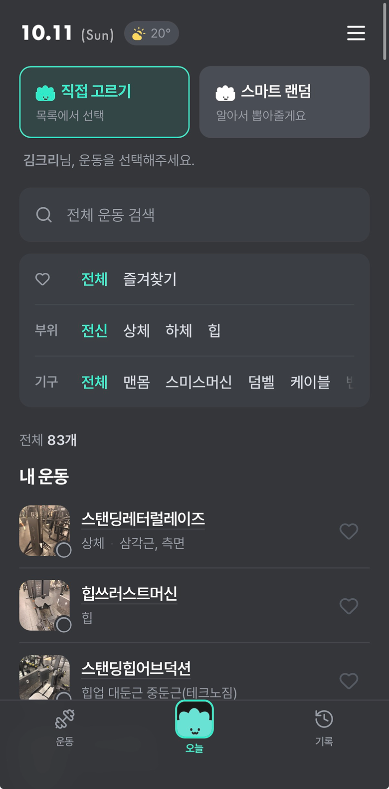
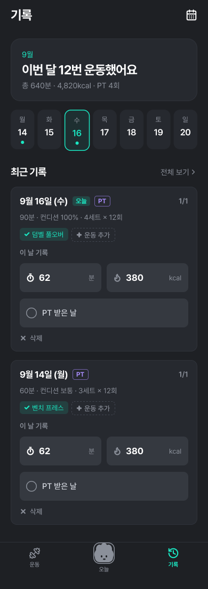
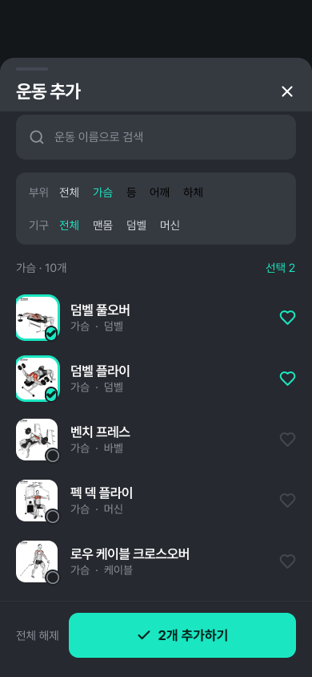
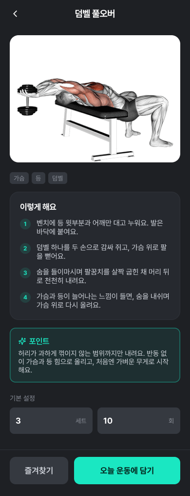
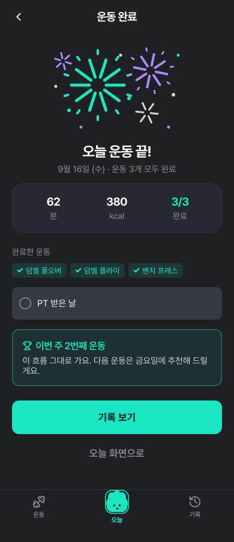

# 실행 기록 — chrifit

> Figma: ChriFit Design System (`EDcJ9a4nsLkEYJDmZPGi80`) · 페이지 `03 Harness` (`35:2`)
> 규칙: docs/design.md · harness/rules.json · 판정 기준: docs/story-service.md (ChriFit)

## S3 키스크린
| 파일 | Figma 노드 |
|---|---|
|  `s3/keyscreen-today.png` | 현재 메인 `58:1070` (03 Harness, 전체 83개) |

초기 S4 화면은 네이티브 Today `22:145`(당시 전체 77개)를 바탕으로 생성했다. 제출용 키스크린 캡처와 하단 바는 사용자가 지정한 현재 메인 `58:1070`에 맞춰 갱신했다.

## S4 화면 (키스크린 1장 → 4장)
`s4/export.json`: harness/figma/export_s4.js로 뽑은 노드 값 (판정 입력)

| # | 화면 | 진입 | Figma 노드 | 이미지 |
|---|---|---|---|---|
| 1 | History | 탭 바 "기록" | `37:22` | `s4/01-history.png` |
| 2 | Add Exercise Sheet | "운동 추가" | `37:23` | `s4/02-add-exercise-sheet.png` |
| 3 | Exercise Detail (덤벨 풀오버) | "설명 보기" | `37:24` | `s4/03-exercise-detail.png` |
| 4 | Workout Done | "오늘 운동 마치기" | `37:25` | `s4/04-workout-done.png` |

   

## 제출용 시각 보정
- `01 Components`의 `Tab Bar` 세 변형에 중앙 얼굴형 마스코트 배지를 반영했다.
- History와 Workout Done 캡처의 하단 탭 바를 새로 내보내고 30px 하단 안전 영역을 적용했다.
- 현재 메인(`58:1070`)은 캡처 이미지이므로 S5 구조 검사 대상 4개 화면과 구분한다.

## S5 검토
`python3 harness/gates/gate_s5.py runs/chrifit` — 판정 스크립트 1회차 위반 49건(폭죽 선 채움 48, 시트 여백 120) → S4에서 수정 → 2회차 0건 통과.

이전 기록:
`s5/report.json` — 1회차 위반 1건(Sheet Header radius 20) → 인스턴스를 `3xl`로 덮어써 0건.

판정 기준을 ChriFit PRD로 바꾼 뒤(★G5-10 이미지 출처) 운동 이미지 노드 6개에 `source=fitnessprogramer`를 레이어 이름으로 달았다.

## 사람 피드백으로 바뀐 것
1. 운동 이름: 임의 예시 → fitnessprogramer.com Chest 목록(덤벨 풀오버 등)
2. 운동 사진 추가 (같은 사이트, 사용 허락됨)
3. 운동 완료: 마스코트 → 폭죽 (색은 accent·pt·ink-2 변수)
4. 상단 헤더: 없던 화면에 ← / X 추가, 높이 56 통일, 제목 title/group(19 Bold)
5. Exercise Detail 헤더 제목: "운동 설명" → "덤벨 풀오버"
